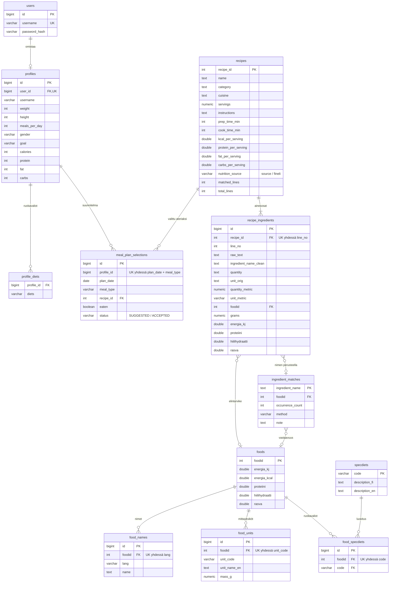

# AI Meal Planner – Backend

[](https://github.com/HH-DarkMode/Meal-Planner-Backend/actions/workflows/ci.yml)

## Projektin kuvaus

**AI Meal Planner** on meal planner -sovelluksen backend. Se tarjoaa REST API:n frontend-sovellukselle ja hoitaa käyttäjän profiilin, reseptihaun ja päivän ateriasuunnitelman.

Käyttäjä tallentaa profiiliin kalori- ja makrotavoitteensa sekä ruokavalionsa. Niiden perusteella backend ehdottaa reseptejä päivän aterioille (aamiainen, lounas, välipala ja päivällinen), ja käyttäjä voi valita ehdotuksista oman ateriasuunnitelmansa.

Reseptit ovat **Zenodon Culinary Recipes Dataset** -aineistosta (noin 50 000 Allrecipes-reseptiä). Reseptien ainesosat on yhdistetty **Finelin** elintarviketietoihin, joiden avulla backend suodattaa reseptit ruokavalion mukaan.

## Ominaisuudet

### Toteutettu

* käyttäjän profiilin tallentaminen: tavoitteet (kalorit, proteiini, rasva, hiilihydraatit), ruokavaliot ja aterioiden määrä päivässä
* reseptihaku kalori- ja makrotavoitteiden perusteella
* päivän ateriaehdotukset: päivän energiatavoite jaetaan aterioille (aamiainen 25 %, lounas 30 %, välipala 15 %, päivällinen 30 %)
* ruokavaliosuodatus: vegetarian, vegan, gluten-free, dairy-free, high-protein ja low-carb
* varoitus, jos ruokavaliosopivuutta ei voi taata, koska osaa ainesosista ei tunnistettu Finelistä
* reseptin ainesosat ja valmistusohjeet
* päivän ateriasuunnitelman valintojen tallentaminen ja tyhjentäminen
* käyttäjän rekisteröityminen ja kirjautuminen JWT-tokenilla

### Suunnitteilla

* viikon meal plan

## Miten reseptit ja ravintoarvot on muodostettu

Data on koottu etukäteen Python-skripteillä yhdeksi PostgreSQL-dumpiksi. Ajon aikana backend lukee valmista dataa tietokannasta.

* **Zenodo** antaa reseptit: nimet, ainesosat, valmistusohjeet, ateriakategoriat ja Allrecipesin oman ravintoarvion per annos.
* **Fineli** antaa elintarvikkeiden ravintoarvot, mittayksiköiden grammamäärät ja erikoisruokavalioluokituksen.
* Reseptien englanninkieliset ainesosat on yhdistetty Finelin elintarvikkeisiin kolmella tavalla: yleisimmille noin 250 ainesosalle tekoälyllä (Claude Sonnet) laaditulla vastaavuuslistalla, muille tarkalla ja sumealla nimivertailulla. Noin 71 % ainesosamaininnoista on tunnistettu.
* Reseptin ravintoarvoina käytetään ensisijaisesti Allrecipesin omaa arviota. Jos se puuttuu, käytetään Finelin perusteella laskettua arvoa, mutta vain jos vähintään 80 % ainesosariveistä on tunnistettu.

## Tietokanta (ER-kaavio)

Sovelluksen omat taulut ovat `users`, `profiles`, `profile_diets` ja `meal_plan_selections`. Reseptit, ainesosat, Finelin elintarvikkeet (`foods`, `food_*`, `specdiets`) ja ainesosien Fineli-vastaavuudet tulevat valmiista dumpista. `recipes`-taulusta on jätetty pois Zenodon ja Finelin raaka-arvot (`src_*`, `calc_*`), joista annoskohtaiset ravintoarvot on laskettu.



`meal_plan_selections.profile_id` viittaa profiiliin, vaikka kannassa ei ole sille vierasavainta. Ruokavaliohaku yhdistää `recipe_ingredients`-taulun `ingredient_matches`-tauluun ainesosan nimellä (`ingredient_name_clean` = `ingredient_name`), ei vierasavaimella.

## REST API

Rekisteröidy tai kirjaudu sisään endpointissa `POST /api/auth/register` tai
`POST /api/auth/login`. Vastauksessa palautetaan `username` ja frontendille JWT
`token`:

```json
{
  "username": "oma-käyttäjä",
  "token": "<jwt>"
}
```

Lähetä token kirjautumisen jälkeisissä API-kutsuissa otsakkeessa
`Authorization: Bearer <jwt>`. Backend asettaa edelleen myös HttpOnly-evästeen,
joten nykyinen evästepohjainen käyttö säilyy. Kirjaudu ulos poistamalla token
frontendin tallennuksesta ja kutsumalla halutessasi `POST /api/auth/logout`.

Kaikki endpointit, hakuparametrit ja vastausten rakenne löytyvät [Swagger UI:sta](https://api-darkmode-aimealplanner.2.rahtiapp.fi/swagger-ui/index.html). Paikallisesti Swagger on osoitteessa <http://localhost:8080/swagger-ui/index.html>.

## Testit

Backendin testit kattavat yksikkötestien lisäksi REST-endpointtien HTTP-tason
käyttäytymisen (`RestApiTest`) ja Spring Boot -integraation autentikoinnista
profiilin tallennukseen (`IntegrationTest`). Testit ajetaan komennolla:

```powershell
.\mvnw.cmd test
```

## Toteutusteknologiat

* **Java** (17 tai uudempi, julkaisussa 25)
* **Spring Boot 4** (Spring Web MVC, Spring Data JPA, Bean Validation)
* **PostgreSQL**
* **springdoc-openapi** (Swagger UI)
* **Maven** (Maven-wrapper repon mukana)
* **Docker**
* **CSC Rahti** (julkaisu, automaattinen build GitHub-webhookilla)
* **GitHub Actions** (CI: build ja testit jokaisessa PR:ssä)
* **Python** (datan esikäsittely Fineli- ja Zenodo-aineistoista)

## Asennus omalle koneelle

Ohje backendin, tietokannan ja frontendin asentamiseen: **[docs/asennusohje-windows.md](docs/asennusohje-windows.md)**

Tietokannan dump-tiedosto ei ole repossa sen koon takia, joten pyydä se tiimiltä.

## Julkaisu Rahtiin

Rahti buildaa ja julkaisee backendin automaattisesti, kun `main`-haaraan tulee muutos (GitHub-webhook). Deployment `meal-planner-backend-git` käyttää profiilia `rahti` ([application-rahti.properties](src/main/resources/application-rahti.properties)) ja tarvitsee seuraavat ympäristömuuttujat:

| Muuttuja | Lähde | Kuvaus |
|---|---|---|
| `SPRING_PROFILES_ACTIVE` | arvo `rahti` | Ottaa käyttöön Rahti-profiilin |
| `DB_USER`, `DB_PASSWORD`, `DB_NAME` | Secret `db` | Tietokannan tunnukset |
| `JWT_SECRET` | Secret `jwt` | JWT-tokenien allekirjoitusavain (vähintään 32 merkkiä). Pakollinen: ilman sitä sovellus ei käynnisty |
| `CORS_ALLOWED_ORIGINS` | arvo | Frontendin julkinen osoite |
| `COOKIE_SECURE` | valinnainen | Oletus Rahdissa `true`. Tarvitaan, koska frontend ja backend ovat eri sivustoilla |

Jos deployment luodaan uudelleen, JWT-avaimen saa liitettyä komennolla:

```bash
oc set env deployment/meal-planner-backend-git --from=secret/jwt
```

JWT-avainta ei tallenneta repoon. Avaimen vaihtaminen kirjaa kaikki käyttäjät ulos.

## Tietojen lähteet ja lisenssit

* Ravintoarvot: **[Fineli](https://fineli.fi/)**, Terveyden ja hyvinvoinnin laitos (THL), Release 20. Lisenssi CC BY 4.0.
* Reseptit: **Culinary Recipes Dataset** ([Zenodo](https://zenodo.org/)), Allrecipes-reseptejä. Lisenssi ODC-BY 1.0.

## Tiimi

* **ghostinth3w1re95-cyber** — [GitHub-profiili](https://github.com/ghostinth3w1re95-cyber)
* **SamuelFizumSemere** — [GitHub-profiili](https://github.com/SamuelFizumSemere)
* **tanjavatka** — [GitHub-profiili](https://github.com/tanjavatka)
* **cofitabs** — [GitHub-profiili](https://github.com/cofitabs)

## Projektin tila

Sprint 2 on valmis ([release](https://github.com/HH-DarkMode/Meal-Planner-Backend/releases/tag/sprint-2)). Backend on julkaistu Rahtiin, ja reseptihaku, ruokavaliosuodatus, profiili ja päivän ateriasuunnitelma toimivat.

## Backlog-linkki
* **https://github.com/orgs/HH-DarkMode/projects/1**

## Frontendin README-linkki
* **https://github.com/HH-DarkMode/Meal-Planner-Frontend/blob/main/README.md**

## Projektin julkaisulinkit

* **[Frontend](https://ai-meal-planner-darkmode.onrender.com/)**
  
* **[Backend](https://api-darkmode-aimealplanner.2.rahtiapp.fi/)**

* **[Swagger UI](https://api-darkmode-aimealplanner.2.rahtiapp.fi/swagger-ui/index.html)**
